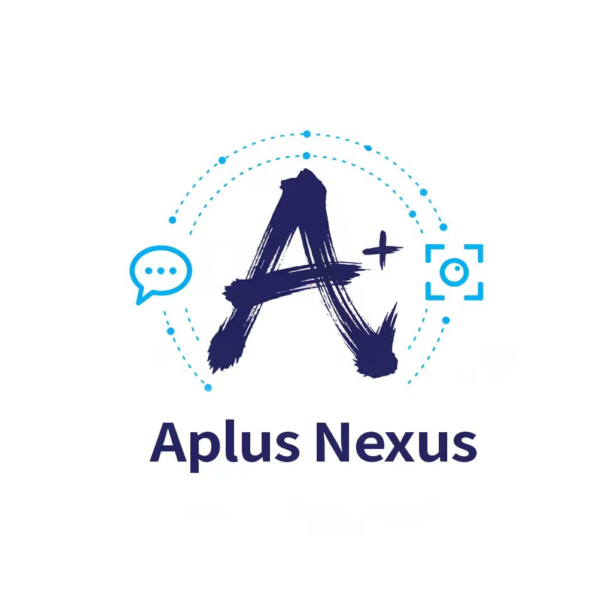
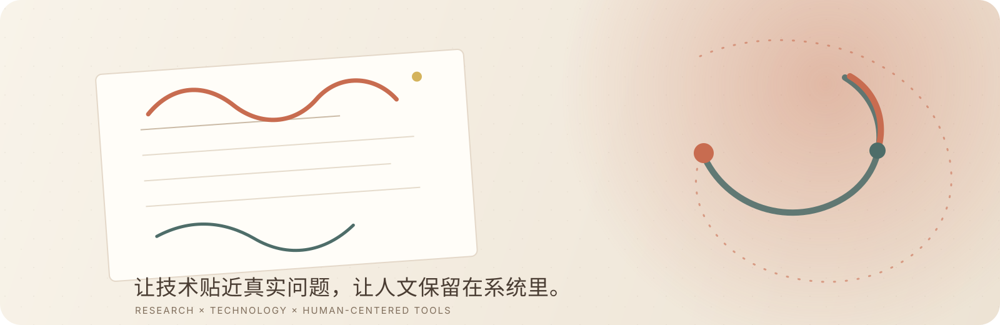

  

  <h1>Aplus 云组会</h1>
  
<strong>科研 × 科技 × 人文</strong> 
  让技术贴近真实问题，让人文保留在系统里。

  

    <a href="https://github.com/Aplus-Nexus?tab=repositories">个人 repositories</a>
    · <a href="https://github.com/MMAC">MMAC 组织</a>
    · <a href="https://www.xiaohongshu.com/user/profile/65546f5f0000000002028ac0">小红书 @Aplus云组会</a>
  

## 你好，这里是 Aplus 云组会

我在 **科研 × 科技 × 人文** 的交界处做东西：研究多模态与情感计算，也做能真正进入日常工作流的小工具。

我喜欢把复杂的问题拆开，把实验做得可复现，把工具做得有分寸。效率很重要，但一套系统如果让人更难理解、更难表达、更难做决定，它就还没有完成。

## MMAC · 组织空间

<table>
  <tr>
    <td width="22%" valign="top" align="center">
      
    </td>
    <td width="78%" valign="top">
      <h3><a href="https://github.com/MMAC">MMAC Organization</a></h3>
      
<strong>一个面向多模态情感计算与人机协作的组织入口。</strong>

      
MMAC 是我们旗下组织品牌与共同研究空间，关注可复现的研究、开放的工具，以及能被更多人继续使用的多模态情感分析基础设施。

      

        <a href="https://github.com/MMAC">进入组织主页</a>
        ·
        <a href="https://github.com/Aplus-Nexus/mmac">查看 MMAC 研究仓库</a>
      

    </td>
  </tr>
</table>

> 组织主页目前作为 MMAC 的公共入口；研究仓库与实验材料会逐步归拢到这个空间。

## 精选工具 · KeyPro

<table>
  <tr>
    <td width="22%" valign="top" align="center">
      
    </td>
    <td width="78%" valign="top">
      <h3><a href="https://github.com/Aplus-Nexus/KeyPro">KeyPro</a></h3>
      
<strong>把重复操作编排成清晰、可预览、可重复运行的跨平台工作流。</strong>

      
面向 macOS 与 Windows 的桌面自动化工具，支持循环、延迟、文字输入、鼠标动作、OCR 尝试和组合键。

      

        <a href="https://github.com/Aplus-Nexus/KeyPro">查看项目</a>
        ·
        <a href="https://github.com/Aplus-Nexus/KeyPro/releases/latest">下载 0.1.0</a>
      

      Desktop automation · Tkinter · macOS · Windows
    </td>
  </tr>
</table>

## 个人实验室 · Personal repositories

这些项目属于我的个人工作台，和 MMAC 组织空间保持清晰区分。

<table>
  <tr>
    <td width="50%" valign="top">
      <h3><a href="https://github.com/Aplus-Nexus/Resonance">Resonance</a></h3>
      
一个可以访问本地文件、谨慎行动的 AI agent，让智能体更接近真实工作。

      Agent · Local-first · Computer use
    </td>
    <td width="50%" valign="top">
      <h3><a href="https://github.com/Aplus-Nexus/EMinder">EMinder</a></h3>
      
把训练监控、日常复盘与邮件提醒串起来的自动化工具。

      Automation · Research workflow · Python
    </td>
  </tr>
  <tr>
    <td width="50%" valign="top">
      <h3><a href="https://github.com/Aplus-Nexus/LifeOL">LifeOL</a></h3>
      
把生活过成游戏：记录事件、积攒成长值，也给每一天留下回声。

      Human-centered · Reflection · TypeScript
    </td>
    <td width="50%" valign="top">
      <h3><a href="https://github.com/Aplus-Nexus/GPT-Continuum">GPT Continuum</a></h3>
      
一个本地 ChatGPT 插件，让被打断的长任务有机会继续向前。

      ChatGPT Plugin · MCP · Small tools
    </td>
  </tr>
  <tr>
    <td width="50%" valign="top">
      <h3><a href="https://github.com/Aplus-Nexus/Aplus-AI-Department-Entrance-Accessment">Aplus AI Department</a></h3>
      
为团队新成员准备的 AI 方向考核与实践入口。

      Community · Practice · AI
    </td>
    <td width="50%" valign="top">
      <h3><a href="https://github.com/Aplus-Nexus/julianryder01.github.io">Personal site</a></h3>
      
个人网站与长期记录的入口。

      Web · Notes · Aplus-Nexus
    </td>
  </tr>
</table>

## 我正在关注

- **多模态情感计算**：让机器不仅看见内容，也能更准确地理解语气、状态与关系
- **AI agents 与工具使用**：让智能体在真实环境里可靠地行动，并且把主动权留在人手里
- **科研工作流与可复现性**：把实验、数据、评估和复盘连接起来，让好的想法可以被继续验证
- **有人的技术**：在自动化之外，保留解释、选择和被看见的空间

## 我相信

> 好的技术不应该把人变成流程的附属品，而是真正解放人。
> 它应该让问题更清楚，让选择更自由，也让人与人之间更容易互相理解。

  <a href="https://www.xiaohongshu.com/user/profile/65546f5f0000000002028ac0">在小红书找到 @Aplus云组会</a>
  ·
  <a href="https://github.com/Aplus-Nexus">Aplus-Nexus</a>
  ·
  <a href="https://github.com/Aplus-Nexus">GitHub profile</a>

